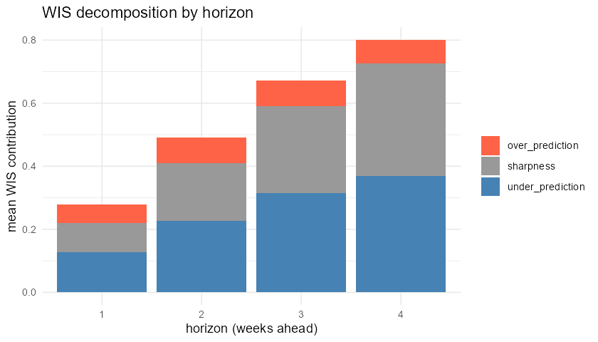
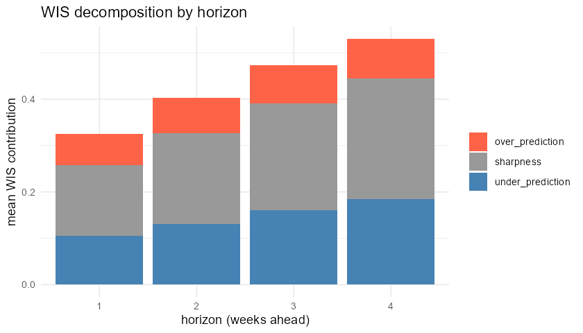
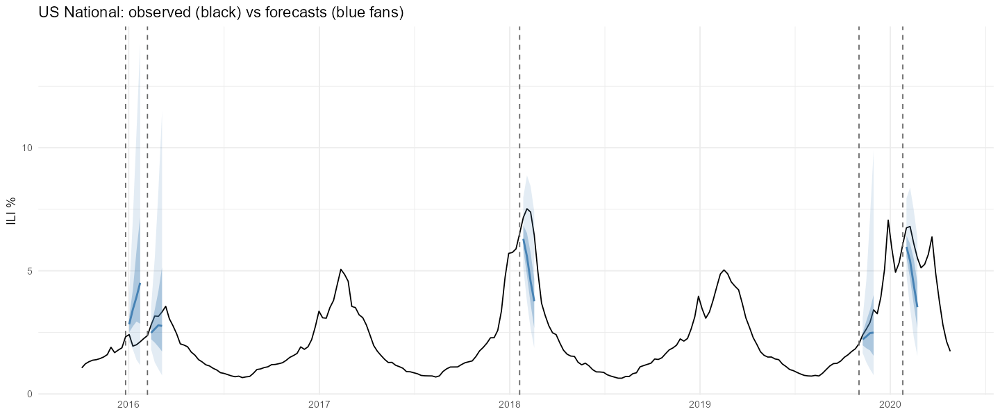

# Forecasting Influenza-Like Illness: SIRS + Ensemble Kalman Filter vs. SARIMA

Probabilistic 1–4 week ahead forecasts of weekly influenza-like illness (ILI %) for the U.S. and its 10 HHS regions, comparing a **mechanistic epidemic model with data assimilation** against a **statistical time-series baseline**. Built in R for INF 599 (Northern Arizona University).

- **5,896 forecasts** (134 origin dates × 11 locations × 4 horizons) across five flu seasons (2015–16 to 2019–20)
- Each forecast is a full predictive distribution (23 quantiles) in the ATSF2026 forecast hub format
- Scored with the **Weighted Interval Score (WIS)**, RMSE, MAE and 50% / 95% interval coverage

## Models

**SIRS + EnKF (mechanistic).** A stochastic SIRS compartmental model (recovery γ = 1/7 day⁻¹, waning immunity ω = 1/180 day⁻¹) simulated with daily tau-leaping. The transmission rate β is a latent state that follows a log-scale Ornstein–Uhlenbeck process with a winter-peaked seasonal mean. A 300-member **Ensemble Kalman Filter** jointly estimates the state and parameter vector `[S, I, R, β]` from weekly ILI observations, then the posterior ensemble is propagated 4 weeks ahead to produce empirical quantiles. Implemented from scratch: [`sirs_tau_leap.R`](R/sirs_tau_leap.R), [`forecast_step.R`](R/forecast_step.R), [`enkf_update.R`](R/enkf_update.R), [`run_forecast.R`](R/run_forecast.R).

**SARIMA (statistical).** The airline model SARIMA(0,1,1)(0,1,1)[52] on log(ILI %), fit per location on all data before each origin date, with quantiles from the Gaussian predictive distribution: [`run_sarima.R`](R/run_sarima.R).

## Results

| Metric | SIRS + EnKF | SARIMA |
|---|---|---|
| Mean WIS ↓ | 0.597 | **0.463** (−22%) |
| RMSE ↓ | 1.46 | **1.11** (−24%) |
| MAE ↓ | 0.84 | **0.70** |
| 95% coverage (nominal 0.95) | 0.91 | **0.96** |
| WIS under-prediction ↓ | 0.26 | **0.15** |

| Horizon | WIS (EnKF) | WIS (SARIMA) |
|---|---|---|
| 1 week | **0.30** | 0.35 |
| 2 weeks | 0.52 | **0.43** |
| 3 weeks | 0.72 | **0.51** |
| 4 weeks | 0.85 | **0.57** |

**Takeaways**
- EnKF wins at 1 week, then SARIMA pulls ahead at longer horizons.
- The two models produce intervals of almost the same width, and they over-predict about equally. Under-prediction accounts for nearly all of the gap. During free-running forecasts the SIRS model uses up its susceptible pool too quickly, so it bends downward while the epidemic is still rising and misses peaks.
- HHS Region 6 is the hardest location for both models. Its flu season peaks earlier than the national average, which the shared seasonal prior for β does not capture.
- Mechanistic structure doesn't automatically help. ILI % is a clinic visit rate, not a true prevalence, so the model's assumptions bias the forecasts. This matches findings in the influenza-forecasting literature (Reich et al., 2019, *PNAS*).

| SIRS + EnKF | SARIMA |
|---|---|
|  |  |



The full write-up is in [`report/INF599_Final_Project_Report.docx`](report/INF599_Final_Project_Report.docx).

## Repository layout

```
R/                      forecasting + evaluation code
  sirs_tau_leap.R         stochastic SIRS simulator (tau-leap)
  forecast_step.R         one-week ensemble propagation with seasonal OU on log(beta)
  enkf_update.R           perturbed-observation EnKF update on [S, I, R, beta]
  run_forecast.R          driver: filter + 4-week forecast for all 134 origin dates
  run_sarima.R            SARIMA(0,1,1)(0,1,1)[52] baseline for the same 134 origin dates
  evaluate_forecasts.R    WIS (with decomposition), RMSE, MAE, coverage, plots
  smoke_test.R            2-date quick check of the pipeline
model-metadata/         hub metadata for each model
model-output/           134 forecast CSVs per model (hub format)
results/<model>/        score tables and plots
report/                 final report
archive/sihr-enkf/      earlier SIHR (hospitalization compartment) variant, kept for reference
```

## Reproducing

Requires R ≥ 4.1 with `dplyr`, `readr`, `tidyr`, `lubridate`, `ggplot2`, `forecast`. Data is read directly from the [ATSF2026 hub](https://github.com/sjfox/ATSF2026). Run from the repository root:

```bash
Rscript R/smoke_test.R                   # quick check (~20 s)
Rscript R/run_forecast.R                 # all 134 SIRS+EnKF forecasts -> model-output/syed-SIRSEnKF/
Rscript R/run_sarima.R                   # all 134 SARIMA forecasts     -> model-output/syed-SARIMA/
Rscript R/evaluate_forecasts.R SIRSEnKF  # -> results/SIRSEnKF/
Rscript R/evaluate_forecasts.R SARIMA    # -> results/SARIMA/
```
